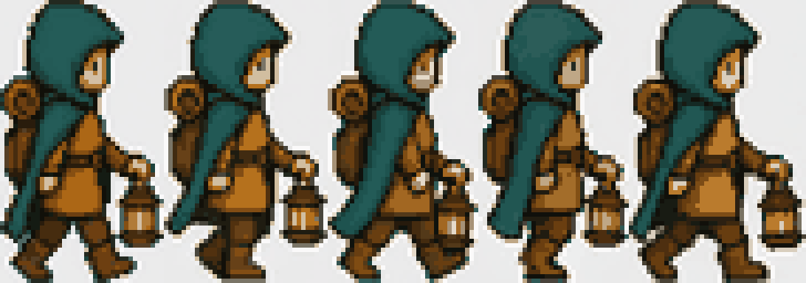
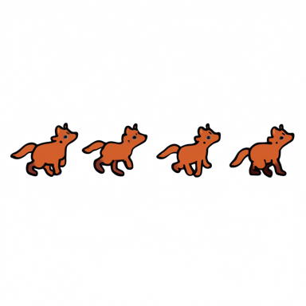
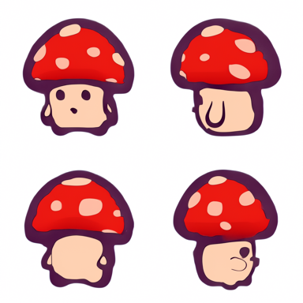
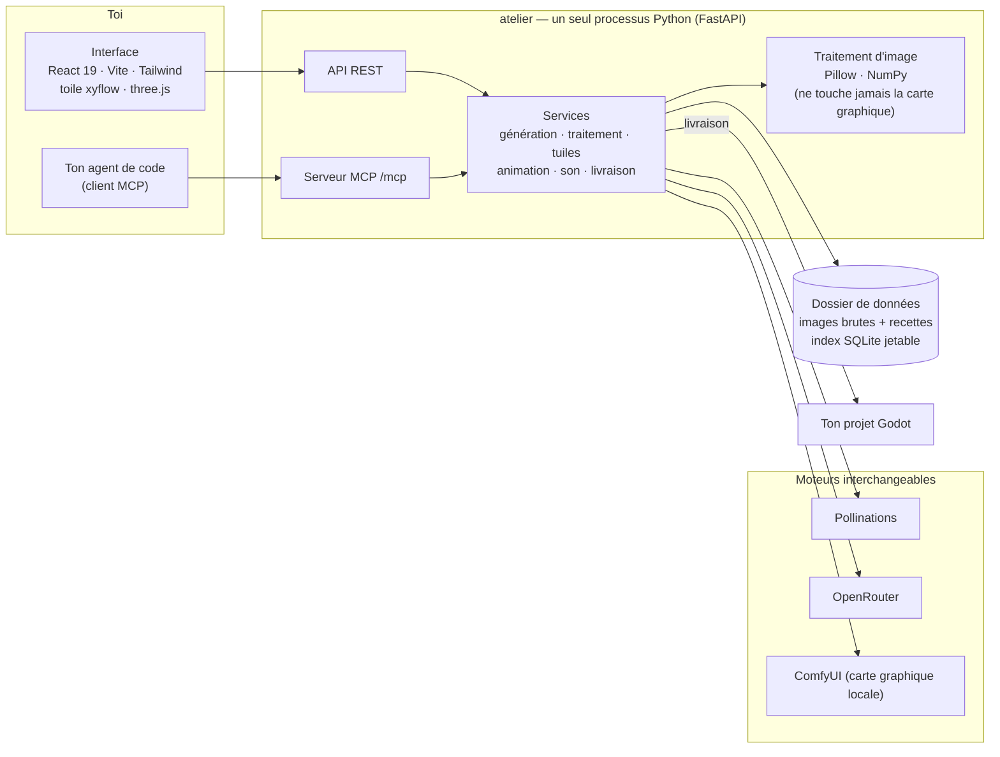

<div align="center">

# 🍳 Asset Kitchen

### Le service graphique de ton jeu, sur ta propre machine.

**Décris ton jeu une fois. Puis cuisine personnages, objets, jeux de tuiles, animations, sons et musiques qui ont tous l'air de venir du même monde — et envoie-les directement dans Godot.**

[](LICENSE)


🇬🇧 **[Read in English](README.md)**



<sub>Un cycle de marche sorti de la cuisine : un sprite, animé par un modèle vidéo, les images choisies, la grille de pixels retrouvée.</sub>

</div>

---

## Sommaire

- [Pourquoi Asset Kitchen ?](#-pourquoi-asset-kitchen-)
- [Ce qu'on y cuisine](#-ce-quon-y-cuisine)
- [Visite de la cuisine](#-visite-de-la-cuisine)
- [Les moteurs : gratuits, payants, et sur ta carte graphique](#-les-moteurs--gratuits-payants-et-sur-ta-carte-graphique)
- [Démarrage rapide](#-démarrage-rapide)
- [Réglages](#%EF%B8%8F-réglages)
- [Brancher ton agent de code (MCP)](#-brancher-ton-agent-de-code-mcp)
- [Comment c'est construit](#%EF%B8%8F-comment-cest-construit)
- [Les règles de la maison](#-les-règles-de-la-maison)
- [Les essais](#-les-essais)
- [S'y retrouver dans le dépôt](#%EF%B8%8F-sy-retrouver-dans-le-dépôt)
- [Où en est le projet, honnêtement](#-où-en-est-le-projet-honnêtement)
- [Contribuer](#-contribuer)
- [Licence](#-licence)

---

## 💡 Pourquoi Asset Kitchen ?

Les modèles d'image savent faire **une** belle image. Un jeu en demande **trois cents** qui s'accordent entre elles : même palette, même angle de caméra, même taille de pixel, le même héros vu de huit côtés, la même épée dans sa main, posée au sol et dans l'inventaire.

Cette cohérence, c'est le plus dur — et elle n'est pas dans le modèle. Elle est dans tout ce qui l'entoure : les références qu'on envoie, le texte qu'on assemble, la grille de pixels qu'on retrouve, le fond qu'on retire, les images qu'on garde, le fichier qu'on dépose enfin dans le jeu.

**Asset Kitchen, c'est ce « tout ce qui l'entoure ».** Un atelier de bureau (une application web locale) où :

1. on écrit l'**univers** du jeu une seule fois — sa bible, son allure, sa vue, ses ambiances, une grande toile de références ;
2. chaque demande en hérite d'elle-même : une fiole et un dragon faits à trois semaines d'écart vont encore ensemble ;
3. chaque résultat entre en **bibliothèque**, traité **sans rien détruire** (l'image brute et la recette sont gardées, le rendu se refait à l'identique en un instant) ;
4. ce qu'on choisit part dans le projet **Godot** en un clic — planches de sprites, `SpriteFrames`, jeux de tuiles, sons ;
5. et l'**agent de code** (Claude Code, Cursor, tout ce qui parle MCP) peut commander des assets tout seul pendant qu'il écrit le jeu, dans les bornes qu'on lui fixe.

Le modèle est un fournisseur. Asset Kitchen, c'est la cuisine.

---

## 🎨 Ce qu'on y cuisine

<table>
<tr>
<td width="50%" align="center">
<br>
<sub><b>Planches d'animation</b> — les images d'une seule génération, découpées en cases, fond transparent.</sub>
</td>
<td width="50%" align="center">
<br>
<sub><b>Planches de directions</b> — un personnage, quatre vues, un appel, un prix.</sub>
</td>
</tr>
</table>

| Famille | Ce qu'on obtient |
|---|---|
| 🧙 **Personnages** | Une image de référence, un **plan de poses** (repos, marche, attaque…) × **directions**, des planches de directions, des animations, un style de combat par personnage |
| 🗡️ **Équipements** | Une pièce (une épée) garde son identité ; ses **emplois** — portée par tel héros, posée au sol, en icône d'inventaire — se préparent en **calques**, sans redemander d'image au modèle |
| 🧪 **Objets** | Fioles, coffres, meubles, ramassables — avec un fond vraiment transparent quand le modèle sait le faire |
| 🏞️ **Décors et terrains** | Arrière-plans, éléments de décor, et **jeux de tuiles sans couture** : l'IA fabrique les *matières*, un code déterministe découpe les pièces d'autotile |
| 🖼️ **Interface** | Boutons, cadres, panneaux, icônes — dans le même style que le reste du jeu |
| 🎬 **Animations** | On anime un sprite par un modèle image-vers-vidéo, puis on **choisit les images qu'on veut**, avec un tempo et une boucle. Finir sur une image choisie, repeindre une zone, laisser de la place autour du sujet avant un grand geste |
| 🔊 **Son** | Bruitages, sons d'interface, ambiances, musiques, chansons et voix — rangés par sujet, calés sur les animations, livrés à Godot en fichiers qu'il lit tels quels. Sons rétro `sfxr` inclus, gratuits |

---

## 🧭 Visite de la cuisine

L'interface est un **carnet** avec huit portes, à gauche :

| Porte | Ce qui s'y passe |
|---|---|
| **Le jeu** | L'écran d'ouverture : ce que le jeu contient, et par où commencer |
| **Univers & toile** | La bible, l'allure (taille de pixel, palette, contour), la vue, les ambiances — et une **toile** libre de références et de notes. Tout ce qui est sur la toile peut devenir un sujet |
| **Codex** | Tout ce que le jeu contient, par **famille** (personnages, objets, décors, terrains, équipements, interface) puis par **collection** (« Les héros ») |
| **Galerie** | Tout ce qui est sorti de l'atelier, du plus récent au plus ancien ; on trie, on filtre, on regroupe par filiation. Juger, c'est juste ⭐ favori ou 🗑️ supprimer — toujours après coup |
| **Fabrications** | Ce qui cuit en ce moment, ce qui a cuit, et ce que chaque appel a coûté |
| **Livrer au jeu** | Ce qui part vers le dossier Godot, relu avant de partir. Un fichier que l'atelier n'a pas écrit devient un **conflit** qui attend ta décision — jamais écrasé en silence |
| **Réglages** | Les règles de l'univers, les moteurs et workflows, l'agent MCP, les consommations |
| **Guide** | La touche `?` ouvre l'explication, écrite à la main, de l'écran où l'on est — 316 fiches sur 25 écrans |

La **fiche d'un sujet** a quatre onglets : Animations, Images, Sons, Équipement. `Ctrl K` ouvre une barre qui cherche, et fait ce qui n'est nulle part à l'écran.

### Les tables de retouche

Chaque image passe par jusqu'à **huit tables**, retirables dans n'importe quel ordre, aucune destructrice :

`Main` · `Détourage` · `Recadrage` · `Pixelisation` · `Couleurs` · `Nettoyage` · `Contour` · `Retournement`

La pixelisation a quatre méthodes (dont [PixelOE](https://github.com/KohakuBlueleaf/PixelOE), qui garde en vie les traits fins comme la hampe d'une lance), la grille d'une image qui a dérivé est **retrouvée**, et une recette rejouée rend **exactement** les mêmes pixels — c'est vérifié par les essais, pas espéré.

### Le coup de main

Un petit assistant de texte qui connaît le produit, et ne fait que trois choses :

- la marque **« EN »** au bout d'un champ de prompt propose une version anglaise *à côté* de la tienne — « Garder » l'adopte, Échap l'oublie ;
- **`Ctrl /`** pose une question libre sur l'atelier ;
- **« pourquoi › »** explique pourquoi un bouton est grisé.

Il ne fabrique rien, ne clique sur rien, ne réécrit jamais ton texte en silence. Il tient sous un plafond mensuel (1 $ par défaut) et se tait sans clé ou sans réseau.

---

## ⚡ Les moteurs : gratuits, payants, et sur ta carte graphique

Le moteur est **interchangeable**. Chaque modèle se nomme par son fournisseur *et* son nom, et le coût d'un appel est annoncé **avant** l'envoi — en argent pour les moteurs en ligne, en temps pour les moteurs locaux.

| Moteur | Pour quoi | Il faut |
|---|---|---|
| **[Pollinations](https://pollinations.ai)** | Des images, gratuitement | Rien — ni compte, ni clé. Marche dès l'installation |
| **[OpenRouter](https://openrouter.ai)** | Beaucoup de modèles d'image, de vidéo et de texte derrière une seule clé | `OPENROUTER_API_KEY` |
| **Local — [ComfyUI](https://github.com/comfyanonymous/ComfyUI)** (« la carte de la maison ») | Des images avec **Qwen-Image** (transparence native), **22 styles locaux** qui prennent une image de référence, l'image-vers-vidéo avec **Wan 2.2**, la musique et le son avec **YuE2**, **ACE-Step**, **Stable Audio** | Un ComfyUI qui tourne et les poids des modèles. Coûte 0 $, coûte du temps |
| **Local — `sfxr`** | Bruitages rétro | Rien |
| **Détourage** | Un détoureur intégré, plus [rembg](https://github.com/danielgatis/rembg) `u2net` en option | L'option `detourage` |

Un moteur absent ne casse jamais rien : ses modèles sont **grisés avec leur raison**, et le reste de la cuisine continue de tourner.

---

## 🚀 Démarrage rapide

> Développé et utilisé tous les jours sous **Windows 11**. Le serveur Python et l'interface React sont multiplateformes, mais le lanceur en un clic est un `.bat` — sous macOS/Linux, utilise les commandes à la main plus bas.

### Il faut

- **Python 3.11+** et [**uv**](https://docs.astral.sh/uv/)
- **Node.js 20+** et npm (pour compiler l'interface ; sert aussi à rendre les jeux de tuiles pour l'agent)
- *En option :* ComfyUI pour générer en local, une clé [OpenRouter](https://openrouter.ai) pour les modèles en ligne, [Godot 4](https://godotengine.org) pour la livraison

### 1. Cloner et installer

```bash
git clone https://github.com/morkibut/Asset-Kitchen.git
```

```bash
cd Asset-Kitchen
```

```bash
uv venv --python 3.11
```

```bash
uv pip install -e ".[dev]"
```

Les options — chacune s'ajoute plus tard ; la fonction qui va avec reste grisée d'ici là :

```bash
uv pip install -e ".[detourage,video,pixelisation]"
```

| Option | Ajoute | Pourquoi elle est à part |
|---|---|---|
| `detourage` | rembg + onnxruntime (un second détoureur) | Télécharge un modèle de 176 Mo au premier usage |
| `video` | imageio + ffmpeg (tirer les images d'un clip) | Embarque un binaire ffmpeg (LGPL) |
| `pixelisation` | PixelOE (une quatrième méthode de pixelisation) | Tire `torch`, plusieurs centaines de Mo |

### 2. (En option) ajouter une clé

```bash
cp .env.example .env
```

Puis mets ta clé OpenRouter dans `.env`. Sans elle, la cuisine tourne avec Pollinations et tes moteurs locaux.

### 3. Lancer

**Windows — double-clic sur `lancer-atelier.bat`.** Il refuse de démarrer deux fois, ne recompile l'interface que si ses sources ont bougé, lance le serveur et ouvre le navigateur sur <http://127.0.0.1:8420>. Fermer la fenêtre noire arrête l'atelier.

**Tout système — à la main :**

```bash
cd interface && npm install && npm run build && cd ..
```

```bash
.venv/bin/python -m atelier
```

(Sous Windows, l'interpréteur est `.venv\Scripts\python.exe`.)

Le premier lancement ouvre un court **tour d'installation** : où l'atelier range ses fichiers, où ComfyUI écoute. Ensuite : crée ton premier jeu, écris quelques lignes de bible, et fabrique ta première image.

---

## ⚙️ Réglages

| Réglage | Où | Par défaut |
|---|---|---|
| Clé OpenRouter | `.env` → `OPENROUTER_API_KEY`, ou *Réglages › Moteurs & workflows* | aucune (Pollinations marche quand même) |
| Dossier de données | variable d'environnement `ATELIER_DONNEES`, ou le tour d'installation | `donnees/` dans le dépôt |
| Adresse de ComfyUI | variable d'environnement `ATELIER_COMFY`, ou *Réglages › Moteurs & workflows* | `http://127.0.0.1:8188` |
| Hôte / port | `python -m atelier --hote 127.0.0.1 --port 8420` | `127.0.0.1:8420` |
| Sans navigateur | `python -m atelier --sans-navigateur` | le navigateur s'ouvre |
| Plafond mensuel du coup de main | *Réglages › Consommations* | 1 $ |

Les choix propres à la machine sont gardés dans `installation.json`, ignoré par Git. Les images, recettes et projets vivent dans le dossier de données — ignoré par Git lui aussi — à côté d'un index SQLite **jetable** qui se reconstruit tout seul.

---

## 🤖 Brancher ton agent de code (MCP)

Asset Kitchen expose un **serveur [MCP](https://modelcontextprotocol.io) de plus de 120 outils**, dans le même processus que l'API, à l'adresse :

```
http://127.0.0.1:8420/mcp
```

L'agent qui écrit ton jeu peut donc, tout seul : lire l'univers et le Codex, créer un sujet et ses objectifs, commander images et animations, préparer les calques d'un équipement, fabriquer jeux de tuiles et sons, relier ton projet Godot, puis **prévisualiser et publier** une livraison. Ce qu'il fabrique paraît en direct dans ta galerie — même disque, mêmes règles, mêmes annonces de prix.

Avec Claude Code, par exemple :

```bash
claude mcp add --transport http atelier http://127.0.0.1:8420/mcp
```

L'agent travaille **dans les bornes que tu lui poses** dans *Réglages › Agent MCP* — jamais à ta place.

---

## 🏗️ Comment c'est construit



- **Serveur** — `atelier/` : Python 3.11, FastAPI + Uvicorn, httpx, Pillow, NumPy, le SDK officiel `mcp`. Le serveur MCP est une dépendance **dure**, monté sur la même application : ce que fait l'agent paraît en direct, sans second écrivain sur le disque.
- **Interface** — `interface/` : React 19, TypeScript, Vite 7, Tailwind 4, `@xyflow/react` pour la toile, `three` pour les aperçus 3D, Vitest + Testing Library.
- **Jeux de tuiles** — le moteur d'autotile n'existe qu'une fois, en TypeScript, dans l'interface. Quand l'agent demande un jeu de tuiles sans écran, le serveur fait tourner ce même code sous Node (`atelier/tuiles_node/rendre.mjs`), et un essai le compare pixel pour pixel à un vrai navigateur.
- **Livraison Godot** — écrit les images, les ressources `.tres` (`SpriteFrames`, jeux de tuiles) et les scènes `.tscn` dans le dossier relié, après un aperçu qu'on relit.
- **3D → sprites** (expérimental) — un pont vers un projet séparé, à base de Blender, rend un modèle sous toutes les directions avec cadre et pivot stables. Ce projet ne fait pas partie de ce dépôt.

---

## 📜 Les règles de la maison

Ce ne sont pas des vœux : chacune est tenue par des essais.

- 💸 **Rien ne part sans que son coût soit annoncé d'abord** — en argent ou en temps. Une planche à plusieurs cases coûte un appel, pas un prix par case.
- 🔍 **« Voir ce qui part »** montre, avant l'envoi, tout ce qu'une demande va réellement transporter — texte, références, réglages. Jamais une supposition.
- ✍️ **Ton texte n'est jamais réécrit en silence.** Une proposition s'affiche à côté ; l'adopter est toujours un second geste.
- 📎 **Ce que tu as joint à la main ne cède jamais devant un plafond du modèle.** Seul ce que le produit a ajouté de lui-même peut céder — et c'est toujours dit.
- ♻️ **Le traitement ne détruit rien.** L'image brute et sa recette sont gardées ; une recette rejouée rend exactement le même résultat.
- 📥 **Toute génération entre en bibliothèque telle quelle**, jugée ou non. La choisir pour le jeu est une décision à part.
- 🚫 **Un fichier que l'atelier n'a pas écrit n'est jamais écrasé.** Il devient un conflit qui t'attend.
- 🔌 **Un moteur ou une bibliothèque absents grisent une fonction avec leur raison** — jamais d'installation à moitié, jamais le reste qui tombe.

---

## 🧪 Les essais

Environ **4 000 essais de serveur et 2 800 essais d'écran**, et **aucun ne coûte un centime** : chaque moteur y est simulé. Les bancs payants vivent à part dans `essais/` et ne partent jamais qu'à la main.

```bash
.venv/bin/python essais/lancer_les_essais.py
```

Lance la suite serveur en parallèle (une dizaine de minutes sur quatre processus). Les marqueurs `lent` (lance un processus extérieur) et `gardefou` (balaie un dossier entier) permettent de trier.

```bash
cd interface && npm test
```

Lance la suite d'écran avec Vitest.

---

## 🗺️ S'y retrouver dans le dépôt

```
atelier/            le serveur Python
  api/              les routes REST, un fichier par domaine
  mcp/              les outils MCP pour les agents de code
  services/         le métier : génération, animation, tuiles, son, livraison…
  fournisseur/      les adaptateurs de moteurs : Pollinations, OpenRouter, ComfyUI, styles locaux
  image/            le traitement d'image : pixeliser, découper, contourer, clips…
  audio/            le traitement du son, sfxr, graphes audio
  domaine/, depot/  le modèle et son stockage
interface/          l'application React (le carnet)
tests/              les essais du serveur
essais/             les bancs — ce qui se mesure au lieu de se supposer ; les payants à la main
docs/               produit, plan, architecture, design, décisions
AGENTS.md           les règles des agents IA qui travaillent dans ce dépôt
lancer-atelier.bat  le lanceur en un clic (Windows)
```

**Par où commencer la lecture :**

| Si tu veux… | Ouvre |
|---|---|
| Ce qu'est le produit, en deux pages | [`docs/fiche-produit.md`](docs/fiche-produit.md) |
| Pourquoi il existe, pour qui | [`docs/PRD.md`](docs/PRD.md) |
| Comment il est assemblé | [`docs/ARCHITECTURE.md`](docs/ARCHITECTURE.md) |
| Ce qui est fait, ce qui vient | [`docs/PLAN.md`](docs/PLAN.md) |
| Chaque fichier, expliqué | [`docs/carte-du-depot.md`](docs/carte-du-depot.md) |
| Les pièges connus | [`docs/PIEGES.md`](docs/PIEGES.md) |
| L'allure de l'interface | [`docs/DESIGN.md`](docs/DESIGN.md) |
| Les règles que suivent les agents ici | [`AGENTS.md`](AGENTS.md) |

---

## 🧭 Où en est le projet, honnêtement

- **C'est un outil personnel, ouvert.** Il a été construit par un auteur pour un jeu, et ça se voit : il a des partis pris, il va loin, et il n'est pas poli pour tout le monde.
- **Tout est en français** — l'interface, les noms dans le code, la doc, les messages de commit. Seul le README existe aussi en anglais. Les traductions sont bienvenues.
- **Windows d'abord.** Linux et macOS devraient marcher à la main, mais ne sont pas essayés tous les jours.
- **Construit avec des agents IA.** La plupart des 800+ commits ont été écrits par Claude Code en suivant des plans écrits (`docs/PLAN*.md`) et des règles (`AGENTS.md`). Ces plans restent dans le dépôt exprès : c'est la meilleure carte du *pourquoi* le code est comme il est.
- **Ça bouge vite.** Plusieurs branches de travail sont souvent ouvertes ; `main` garde ce qui a été fusionné.
- **Hors du périmètre :** mobile, comptes multiples, place de marché, jugement artistique automatique, moteur de jeu intégré, modélisation 3D complète.

---

## 🤝 Contribuer

Forks, tickets et pull requests sont bienvenus — voir **[CONTRIBUTING.md](CONTRIBUTING.md)**. En bref : ouvre d'abord un ticket pour tout gros changement, respecte les règles de la maison, et vérifie que les suites d'essais gratuites passent.

Bonnes premières contributions : une traduction anglaise de l'interface, des lanceurs Linux/macOS, un nouvel adaptateur de moteur dans `atelier/fournisseur/`, une nouvelle cible d'export à côté de Godot.

---

## 📄 Licence

Asset Kitchen est un logiciel libre sous **[licence publique générale GNU v3.0](LICENSE)**. Tu peux l'utiliser, l'étudier, le modifier et le partager ; si tu distribues une version modifiée, elle doit rester sous GPL, avec ses sources disponibles.

**Les poids des modèles et les services tiers ne sont pas couverts par cette licence.** Chaque moteur branché a ses propres conditions — certains modèles locaux (YuE2, par exemple, sous CC BY-NC 4.0) interdisent l'usage commercial de ce qu'ils produisent. Vérifie-les avant de vendre un jeu fait avec eux.

<div align="center">
<br>
<sub>Fait avec obstination, beaucoup de plans écrits, et un voyageur encapuchonné qui a refait ce cycle de marche mille fois. 🏮</sub>
</div>
