<div align="center">

# 🍳 Asset Kitchen

### Your game's art department, running on your own machine.

**Describe your game once. Then cook characters, props, tilesets, animations, sounds and music that all look like they belong together — and ship them straight into Godot.**

[](LICENSE)


🇫🇷 **[Lire en français](README.fr.md)**

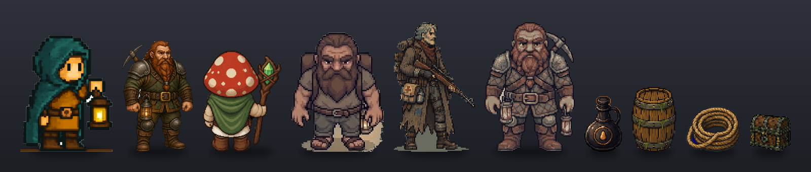

<sub>Every sprite on this page came out of the kitchen, from the author's own games — nothing was retouched outside it.</sub>

<br>

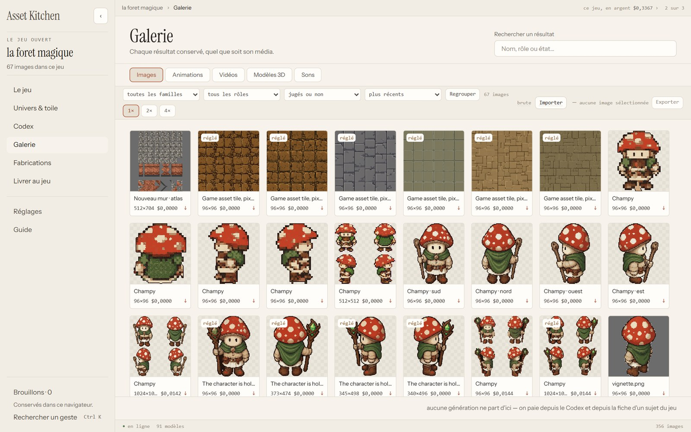

</div>

---

## Table of contents

- [Why Asset Kitchen?](#-why-asset-kitchen)
- [What it can cook](#-what-it-can-cook)
- [A tour of the kitchen](#-a-tour-of-the-kitchen)
- [Engines: free, paid, and on your own GPU](#-engines-free-paid-and-on-your-own-gpu)
- [Quick start](#-quick-start)
- [Configuration](#%EF%B8%8F-configuration)
- [Plug in your coding agent (MCP)](#-plug-in-your-coding-agent-mcp)
- [How it is built](#%EF%B8%8F-how-it-is-built)
- [The house rules](#-the-house-rules)
- [Tests](#-tests)
- [Find your way in the repo](#%EF%B8%8F-find-your-way-in-the-repo)
- [Status and honest caveats](#-status-and-honest-caveats)
- [Contributing](#-contributing)
- [License](#-license)

---

## 💡 Why Asset Kitchen?

AI image models are great at making **one** nice picture. A game needs **three hundred** pictures that agree with each other: same palette, same camera angle, same pixel size, the same hero from eight directions, the same sword in the hero's hand, on the floor and in the inventory.

That consistency is the hard part — and it is not in the model. It is in everything around it: the references you send, the prompt you assemble, the pixel grid you snap back to, the background you remove, the frames you keep, the file you finally drop into your game.

**Asset Kitchen is that "everything around it".** It is a desktop workshop (a local web app) where:

1. you write your game's **universe** once — its bible, its look, its camera, its moods, a big canvas of references;
2. every request you make inherits it automatically, so a potion and a dragon made three weeks apart still match;
3. every result lands in a **library**, processed **non-destructively** (the raw image and the recipe are kept, re-rendering is instant and exact);
4. what you choose goes to your **Godot** project in one click — sprite sheets, `SpriteFrames`, tilesets, sounds;
5. and your **coding agent** (Claude Code, Cursor, anything that speaks MCP) can order assets by itself while it writes the game, within the limits you set.

Think of the model as a supplier. Asset Kitchen is the kitchen.

---

## 🎨 What it can cook

<table>
<tr>
<td width="50%" align="center">
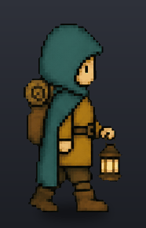<br>
<sub><b>A walk cycle</b> — the sprite animated by a video model, eight frames kept, pixel grid restored.</sub>
</td>
<td width="50%" align="center">
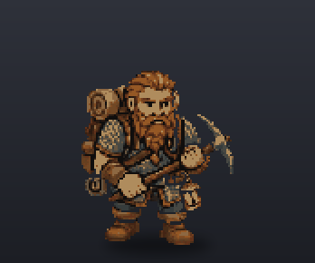<br>
<sub><b>An action</b> — a dwarf mining, ten frames cut from one generation, transparent background.</sub>
</td>
</tr>
</table>

<p align="center">
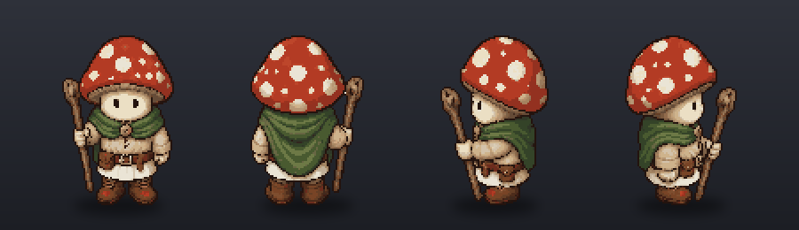<br>
<sub><b>Direction sheets</b> — one character, four views, one call, one price.</sub>
</p>

<p align="center">
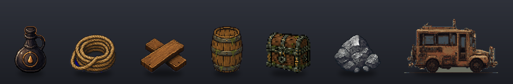<br>
<sub><b>Objects & props</b> — in the same style as the characters, without a background to remove by hand.</sub>
</p>

<p align="center">
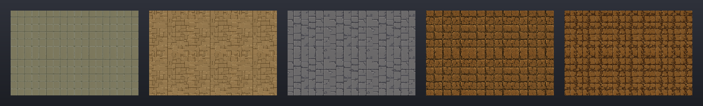<br>
<sub><b>Materials</b> — each one repeated 3 × 2 to show it tiles without a seam. The tileset engine cuts the autotile pieces from them.</sub>
</p>

| Family | What you get |
|---|---|
| 🧙 **Characters** | A reference image, a **pose plan** (idle, walk, attack…) × **directions**, direction sheets, animations, a combat style per character |
| 🗡️ **Equipment** | A piece (a sword) keeps its identity; its **uses** — held by this hero, lying on the ground, as an inventory icon — are prepared as **layers**, without asking the model again |
| 🧪 **Objects & props** | Potions, chests, furniture, pickups — with native transparency when the model supports it |
| 🏞️ **Scenery & terrain** | Backgrounds, decor pieces, and **seamless tilesets**: AI makes the *materials*, deterministic code cuts the autotile pieces |
| 🖼️ **Interface** | Buttons, frames, panels, icons — in the same style as the rest of the game |
| 🎬 **Animations** | Animate a sprite through an image-to-video model, then **pick the frames you want**, set tempo and loop. Finish on a chosen frame, repaint a zone, leave room around the subject before a big move |
| 🔊 **Sound** | Sound effects, UI sounds, ambiences, music, songs and voices — stored per subject, synced to animations, delivered to Godot as files it reads as-is. Retro `sfxr` sounds included, free |

---

## 🧭 A tour of the kitchen

The interface is a **notebook** with eight doors on the left:

| Door | What happens there |
|---|---|
| **The game** | The opening screen: what your game contains and where to start |
| **Universe & canvas** | The bible, the look (pixel size, palette, outline), the camera, the moods — and a free-form **canvas** of references and notes. Anything on the canvas can become a subject |
| **Codex** | Everything your game contains, by **family** (characters, objects, scenery, terrain, equipment, interface) then by **collection** ("The heroes") |
| **Gallery** | Everything that came out of the kitchen, newest first; sort, filter, group by lineage. Judging is just ⭐ favourite or 🗑️ delete — always after the fact |
| **Productions** | What is cooking right now, what has been cooked, and what each call cost |
| **Deliver to the game** | What leaves for your Godot folder, reviewed before it goes. A file the kitchen did not write is a **conflict** waiting for your decision — never silently overwritten |
| **Settings** | Universe rules, engines & workflows, MCP agent, and spending |
| **Guide** | The `?` key opens a hand-written explanation of the screen you are on — 316 cards over 25 screens |

A **subject sheet** has four tabs: Animations, Images, Sounds, Equipment. `Ctrl K` opens a command bar that searches and does what is not on screen.

<table>
<tr>
<td width="50%">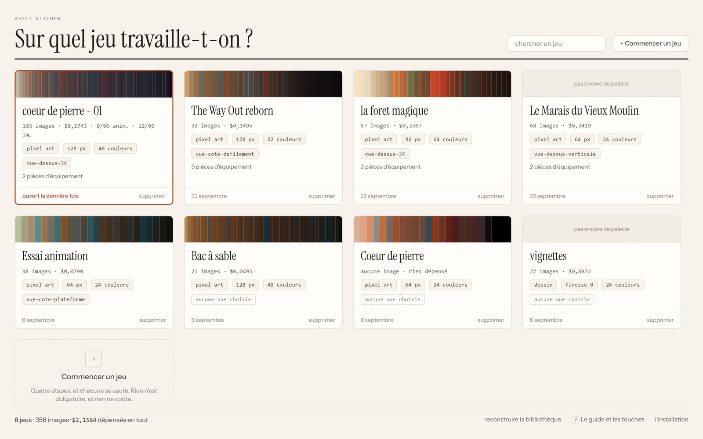<br><sub><b>Your games</b> — each with its palette, pixel size, camera and what it has cost so far.</sub></td>
<td width="50%">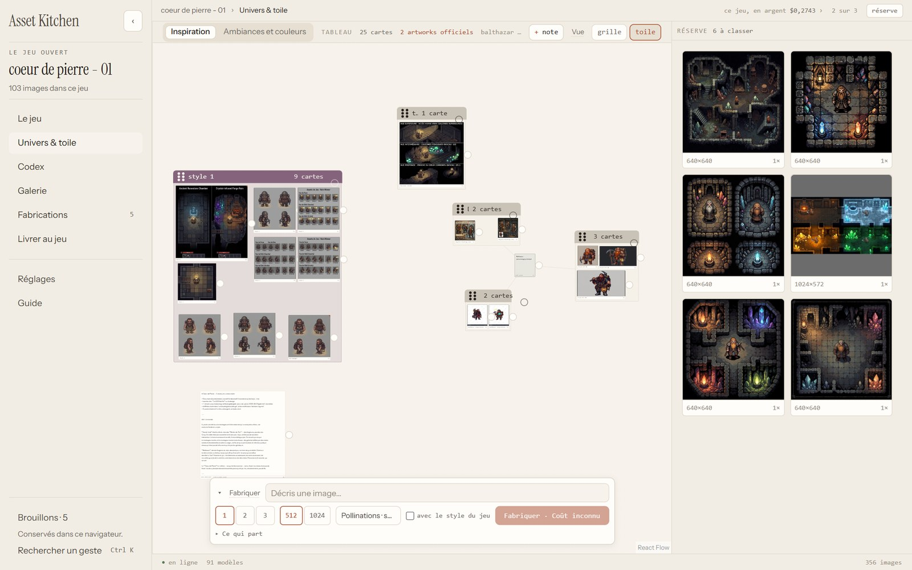<br><sub><b>Universe & canvas</b> — references, notes and style groups on a free board; the prompt bar sits at the bottom.</sub></td>
</tr>
<tr>
<td width="50%">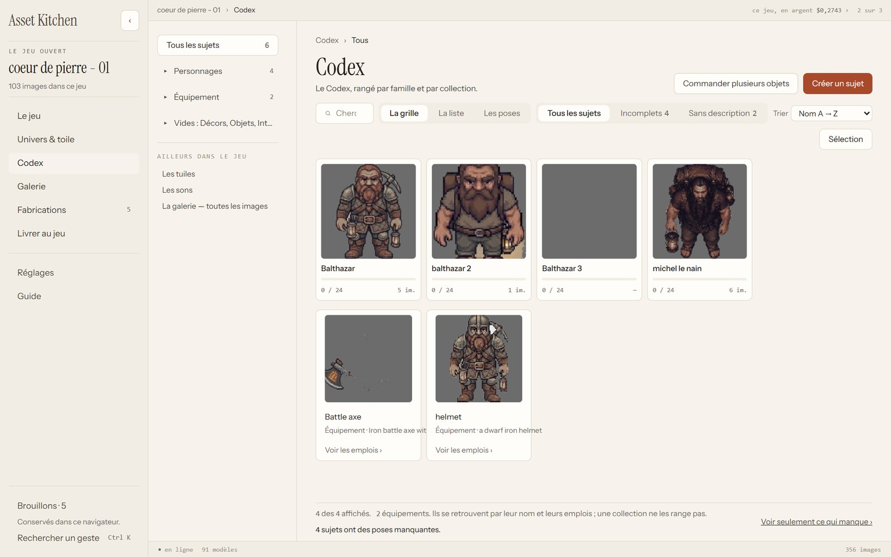<br><sub><b>Codex</b> — every subject of the game, by family, with how much of it is ready.</sub></td>
<td width="50%">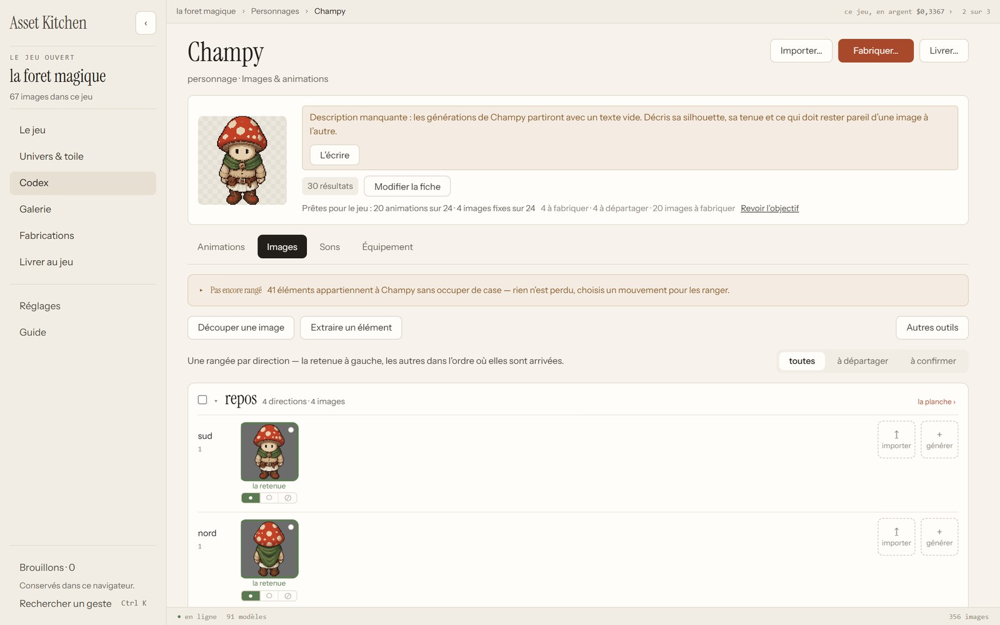<br><sub><b>A subject sheet</b> — the chosen image per pose and direction, and what is still to make.</sub></td>
</tr>
</table>

### The retouching tables

Every image goes through up to **eight tables**, each removable in any order, none destructive:

`Hand` · `Background removal` · `Crop` · `Pixelate` · `Colours` · `Clean-up` · `Outline` · `Flip`

Pixelation has four methods (including [PixelOE](https://github.com/KohakuBlueleaf/PixelOE), which keeps thin lines such as a spear shaft alive), the grid of an image that drifted is **found again**, and replaying a recipe always gives **exactly** the same pixels — that is tested, not hoped for.

### The little helper

A small text assistant that knows the product, and does three things only:

- an **"EN"** mark at the end of a prompt field proposes an English rewrite *next to* yours — `Keep` adopts it, `Esc` forgets it;
- **`Ctrl /`** asks a free question about the workshop;
- **"why ›"** explains why a button is greyed out.

It never builds anything, never clicks, never rewrites your text in silence. It runs under a monthly cap (1 $ by default) and goes quiet without a key or a network.

---

## ⚡ Engines: free, paid, and on your own GPU

The engine is **interchangeable**. Every model is named by its provider *and* its name, and the cost of a call is announced **before** you send it — in money for cloud engines, in time for local ones.

| Engine | What for | Needs |
|---|---|---|
| **[Pollinations](https://pollinations.ai)** | Images, free | Nothing — no account, no key. Works out of the box |
| **[OpenRouter](https://openrouter.ai)** | Many image, video and text models behind one key | `OPENROUTER_API_KEY` |
| **Local — [ComfyUI](https://github.com/comfyanonymous/ComfyUI)** ("the house card") | Images with **Qwen-Image** (native transparency), **22 local styles** that take a reference image, image-to-video with **Wan 2.2**, music and sound with **YuE2**, **ACE-Step**, **Stable Audio** | A running ComfyUI and the model weights. Costs 0 $, costs time |
| **Local — `sfxr`** | Retro sound effects | Nothing |
| **Background removal** | Built-in remover, plus optional [rembg](https://github.com/danielgatis/rembg) `u2net` | Optional extra `detourage` |

A missing engine never crashes anything: its models are **greyed out with the reason**, and the rest of the kitchen keeps working.

---

## 🚀 Quick start

> Developed and used daily on **Windows 11**. The Python server and the React interface are cross-platform, but the one-click launcher is a `.bat` — on macOS/Linux, use the manual commands below.

### Requirements

- **Python 3.11+** and [**uv**](https://docs.astral.sh/uv/)
- **Node.js 20+** and npm (to build the interface; also used to render tilesets for the agent)
- *Optional:* ComfyUI for local generation, an [OpenRouter](https://openrouter.ai) key for cloud models, [Godot 4](https://godotengine.org) for delivery

### 1. Clone and install

```bash
git clone https://github.com/morkibut/Asset-Kitchen.git
```

```bash
cd Asset-Kitchen
```

```bash
uv venv --python 3.11
```

```bash
uv pip install -e ".[dev]"
```

Optional extras — each can be added later; the matching feature stays greyed out until then:

```bash
uv pip install -e ".[detourage,video,pixelisation]"
```

| Extra | Adds | Why it is optional |
|---|---|---|
| `detourage` | rembg + onnxruntime (a second background remover) | Downloads a 176 MB model on first use |
| `video` | imageio + ffmpeg (reading frames out of clips) | Bundles an ffmpeg binary (LGPL) |
| `pixelisation` | PixelOE (a fourth pixelation method) | Pulls in `torch`, several hundred MB |

### 2. (Optional) add a key

```bash
cp .env.example .env
```

Then put your OpenRouter key in `.env`. Without it, the kitchen cooks with Pollinations and your local engines.

### 3. Launch

**Windows — double-click `lancer-atelier.bat`.** It refuses to start twice, rebuilds the interface only when its sources changed, starts the server and opens your browser at <http://127.0.0.1:8420>. Close the black window to stop.

**Any OS — by hand:**

```bash
cd interface && npm install && npm run build && cd ..
```

```bash
.venv/bin/python -m atelier
```

(On Windows the interpreter is `.venv\Scripts\python.exe`.)

The first launch walks you through a short **installation tour**: where the kitchen stores its files, where ComfyUI listens. Then create your first game, write a few lines of bible, and make your first image.

---

## ⚙️ Configuration

| Setting | Where | Default |
|---|---|---|
| OpenRouter key | `.env` → `OPENROUTER_API_KEY`, or *Settings › Engines* | none (Pollinations still works) |
| Data folder | `ATELIER_DONNEES` environment variable, or the installation tour | `donnees/` in the repo |
| ComfyUI address | `ATELIER_COMFY` environment variable, or *Settings › Engines* | `http://127.0.0.1:8188` |
| Host / port | `python -m atelier --hote 127.0.0.1 --port 8420` | `127.0.0.1:8420` |
| No browser | `python -m atelier --sans-navigateur` | the browser opens |
| Helper monthly cap | *Settings › Spending* | 1 $ |

Machine-specific choices are saved in `installation.json`, which is git-ignored. Your images, recipes and projects live in the data folder — also git-ignored — next to a **disposable** SQLite index that rebuilds itself.

---

## 🤖 Plug in your coding agent (MCP)

Asset Kitchen exposes an **[MCP](https://modelcontextprotocol.io) server with 120+ tools**, in the same process as the API, at:

```
http://127.0.0.1:8420/mcp
```

So the agent that writes your game can, on its own: read the universe and the Codex, create a subject and its objectives, order images and animations, prepare equipment layers, make tilesets and sounds, link your Godot project, and **preview then publish** a delivery. Whatever it makes shows up live in your gallery — same disk, same rules, same price announcements.

With Claude Code, for example:

```bash
claude mcp add --transport http atelier http://127.0.0.1:8420/mcp
```

The agent works **inside the limits you set** in *Settings › MCP agent* — never instead of you.

---

## 🏗️ How it is built

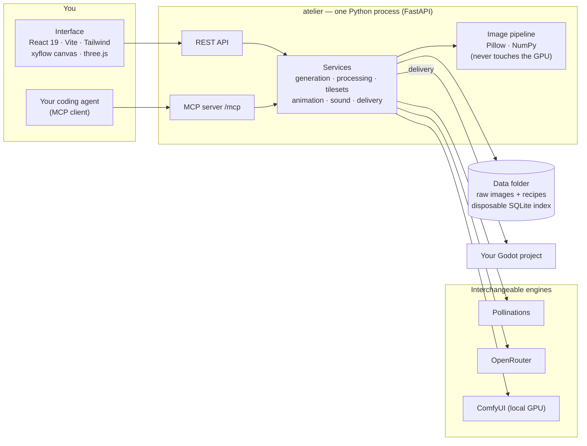

- **Backend** — `atelier/`: Python 3.11, FastAPI + Uvicorn, httpx, Pillow, NumPy, the official `mcp` SDK. The MCP server is a **hard** dependency, mounted on the same app: what the agent makes appears live, with no second writer on the disk.
- **Frontend** — `interface/`: React 19, TypeScript, Vite 7, Tailwind 4, `@xyflow/react` for the canvas, `three` for 3D previews, Vitest + Testing Library.
- **Tilesets** — the autotile engine exists once, in TypeScript, in the interface. When the agent asks for a tileset without a screen, the server runs that same code under Node (`atelier/tuiles_node/rendre.mjs`), and a test checks it pixel for pixel against a real browser.
- **Godot delivery** — writes images, `.tres` resources (`SpriteFrames`, tilesets) and `.tscn` scenes into the folder you linked, after a preview you can read.
- **3D → sprites** (experimental) — a bridge to a separate Blender-based project renders a model from every direction with a stable frame and pivot. That project is not part of this repository.

---

## 📜 The house rules

These are not wishes: each one is held by tests.

- 💸 **Nothing leaves without its cost announced first** — money or time. A sheet with many cells costs one call, not one per cell.
- 🔍 **"See what leaves"** shows, before sending, everything a request will really carry — text, references, settings. Never a guess.
- ✍️ **Your text is never rewritten in silence.** Suggestions sit next to it; adopting one is always a second gesture.
- 📎 **What you attached by hand never gives way to a model limit.** Only what the product added itself may be dropped — and that is always said.
- ♻️ **Processing is non-destructive.** The raw image and its recipe are kept; replaying a recipe gives the exact same result.
- 📥 **Every generation joins the library as it is**, judged or not. Choosing it for the game is a separate decision.
- 🚫 **A file the kitchen did not write is never overwritten.** It becomes a conflict that waits for you.
- 🔌 **A missing engine or library greys out a feature with its reason** — it never half-installs, never brings the rest down.

---

## 🧪 Tests

About **4,000 server tests and 2,800 interface tests**, and **none of them costs a cent**: every engine is faked. Paid benchmarks live apart in `essais/` and only ever run by hand.

```bash
.venv/bin/python essais/lancer_les_essais.py
```

Runs the server suite in parallel (about ten minutes on four processes). The markers `lent` (spawns an external process) and `gardefou` (scans a whole folder) let you sort.

```bash
cd interface && npm test
```

Runs the interface suite with Vitest.

---

## 🗺️ Find your way in the repo

```
atelier/            Python server
  api/              REST routes, one file per area
  mcp/              MCP tools for coding agents
  services/         the business: generation, animation, tilesets, sound, delivery…
  fournisseur/      engine adapters: Pollinations, OpenRouter, ComfyUI, local styles
  image/            the image pipeline: pixelate, cut, outline, clips…
  audio/            sound processing, sfxr, audio graphs
  domaine/, depot/  the model and its storage
interface/          the React app (the notebook)
tests/              server tests
essais/             benchmarks — measured, not assumed; paid ones run by hand
docs/               product, plan, architecture, design, decisions
AGENTS.md           the rules for AI agents working in this repo
lancer-atelier.bat  one-click launcher (Windows)
```

**Where to start reading** (all in French):

| If you want… | Open |
|---|---|
| What the product is, in two pages | [`docs/fiche-produit.md`](docs/fiche-produit.md) |
| Why it exists, who it is for | [`docs/PRD.md`](docs/PRD.md) |
| How it is put together | [`docs/ARCHITECTURE.md`](docs/ARCHITECTURE.md) |
| What is done, what is next | [`docs/PLAN.md`](docs/PLAN.md) |
| Every file, explained | [`docs/carte-du-depot.md`](docs/carte-du-depot.md) |
| Known traps | [`docs/PIEGES.md`](docs/PIEGES.md) |
| The look of the interface | [`docs/DESIGN.md`](docs/DESIGN.md) |
| The rules agents follow here | [`AGENTS.md`](AGENTS.md) |

---

## 🧭 Status and honest caveats

- **It is a personal tool, opened up.** It was built by one author for one game, and it shows: it is opinionated, deep, and not polished for everyone.
- **Everything is in French** — the interface, the code identifiers, the docs, the commit messages. This README is the only English page. Translations are welcome.
- **Windows first.** Linux and macOS should work by hand but are not tested daily.
- **Built with AI agents.** Most of the 800+ commits were written by Claude Code following written plans (`docs/PLAN*.md`) and rules (`AGENTS.md`). Those plans stay in the repo on purpose: they are the best map of *why* the code is the way it is.
- **Moving fast.** Several feature branches are usually open; `main` holds what has been merged.
- **Out of scope:** mobile, multi-user accounts, a marketplace, automatic artistic judgement, a built-in game engine, full 3D modelling.

---

## 🤝 Contributing

Forks, issues and pull requests are welcome — see **[CONTRIBUTING.md](CONTRIBUTING.md)**. In short: open an issue first for anything big, keep the house rules, and make sure the free test suites pass.

Good first contributions: an English translation of the interface, Linux/macOS launch scripts, a new engine adapter in `atelier/fournisseur/`, a new export target next to Godot.

---

## 📄 License

Asset Kitchen is free software under the **[GNU General Public License v3.0](LICENSE)**. You can use, study, modify and share it; if you distribute a modified version, it must stay under the GPL with its source available.

**Model weights and third-party services are not covered by this license.** Each engine you plug in has its own terms — some local models (YuE2, for instance, under CC BY-NC 4.0) forbid commercial use of what they produce. Check them before you sell a game made with them.

<div align="center">
<br>
<sub>Made with stubbornness, a lot of written plans, and a hooded traveller who has walked this cycle a thousand times. 🏮</sub>
</div>
